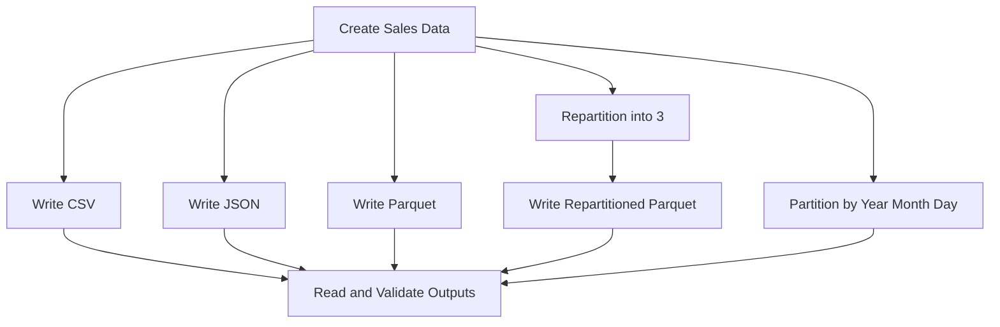

# Day 20 — File Formats and Output in Apache Spark

## Project Overview
This project demonstrates reading and writing CSV, JSON, and Parquet files using Scala and Apache Spark. It also explores repartitioning and partitioned output for daily sales data.

## Objectives
- Read and write CSV, JSON, and Parquet.
- Use `repartition()` before writing.
- Partition sales output by year, month, and day.
- Inspect the output folder structure and number of data files.

## Technologies
- Scala 2.12.18
- Apache Spark 3.5.3
- Spark SQL
- Java 17
- sbt 1.12.15

## Workflow



## Dataset
The sample dataset contains six sales records with sale ID, product, amount, and sale date. The program derives year, month, and day columns from the sale date.

## Results

| Output | Observed data files |
|---|---:|
| CSV | 6 |
| JSON | 6 |
| Parquet | 6 |
| Repartitioned Parquet | 3 |
| Daily partitioned Parquet | 3 |

These are the counts observed in this local Spark run. File counts can vary with input partitions, execution plans, and data distribution.

## Output Folder Structure

```text
output/
├── csv/
├── json/
├── parquet/
├── repartitioned_parquet/
└── daily_sales/
    └── year=2026/
        ├── month=10/
        │   ├── day=10/
        │   └── day=11/
        └── month=11/
            └── day=1/
```

## Key Concepts

### CSV
A text-based format that is easy to inspect and exchange with other applications.

### JSON
A semi-structured format suitable for records represented as JSON objects.

### Parquet
A columnar storage format commonly used for analytical workloads.

### Repartition
`repartition(3)` reshuffles the DataFrame into three partitions before writing. In this run, it produced three data files.

### Partitioned Output
`partitionBy("year", "month", "day")` creates a directory hierarchy based on those column values. Here, the six records span three distinct dates, resulting in three date directories and three data files.

## How to Run

```bash
sbt clean compile
sbt "runMain FileFormatsOutput"
```

## Key Learning
File format determines how data is stored, repartitioning controls the DataFrame's partition layout, and `partitionBy` organizes output into directories by column values. The exact number of files depends on the execution and data distribution.
